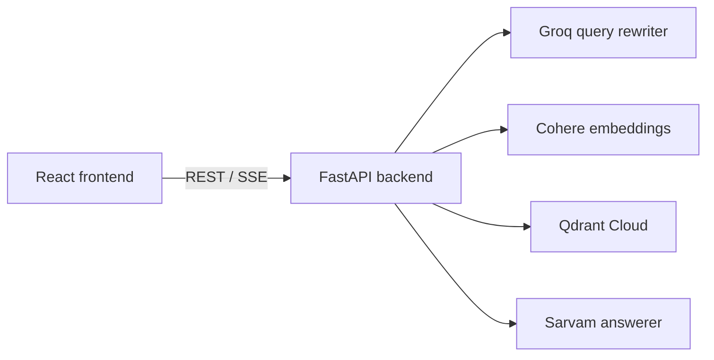

# ParAILegal

ParAILegal is an AI-powered Indian legal research tool. Ask a question about Indian law and get a grounded answer with clickable citations, traced back to primary sources: the Constitution of India, the BNS 2023, BNSS 2023, BSA 2023, and landmark Supreme Court judgments.

> This is a research tool, not legal advice. Verify every provision against the official Gazette and consult a qualified advocate for legal advice.

## Download (Windows)

ParAILegal runs as a desktop app for Windows 10 and 11 (64-bit), and works offline once set up.

1. Download **`ParAILegal_0.1.0_x64-setup.exe`** (271 MB) from the [Releases page](https://github.com/sarthak213/ParAILegal/releases/latest).
2. Run it. It installs for your user only, so no administrator rights are needed.
3. Open ParAILegal and go to **Downloads** to fetch the rest once. These are hosted on Hugging Face:

   | Download | Size | What it adds | Source |
   |---|---|---|---|
   | Answer model (Qwen3.5 4B) | 2.7 GB | Written answers. Without it, Research lists the matching provisions. | [Sarthak213/parailegal-models](https://huggingface.co/Sarthak213/parailegal-models) |
   | Supreme Court judgments | 1.0 GB | Judgments search, the citator, precedents and leading cases | [Sarthak213/parailegal-sc-judgments](https://huggingface.co/datasets/Sarthak213/parailegal-sc-judgments) |
   | Case Builder model (Qwen3.5 9B) | 5.6 GB | The Case Builder, which stays locked until it is installed | [Sarthak213/parailegal-models](https://huggingface.co/Sarthak213/parailegal-models) |

   Downloads resume if they stop, and each file is checked against its SHA-256 before the app uses it.

### The installer is not code-signed

The installer is **not code-signed**, so Windows SmartScreen will warn that it is from an unknown publisher the first time you run it. To go ahead, choose **More info**, then **Run anyway**.

Check that your copy is the one published here before you run it. In PowerShell:

```powershell
Get-FileHash .\ParAILegal_0.1.0_x64-setup.exe -Algorithm SHA256
```

The hash should be:

```text
4d7b19c5652a6239821a11c835ea7c008ebd93c16ecd32792591d8217ff22c8e
```

If it differs, do not run the file.

## Repository Layout

```text
backend/    FastAPI RAG API — routing, query rewriting, Qdrant retrieval, grounded answers
frontend/   React + TypeScript + Vite web app — streaming answers, citations, sources panel
```



## Quick Start

You need Python 3.10+, Node.js, API keys for Sarvam, Groq, and Cohere, and a Qdrant instance.

**1. Backend** — see [backend/README.md](backend/README.md) for configuration, corpus data, and ingestion.

```powershell
cd backend
python -m venv .venv
.\.venv\Scripts\Activate.ps1
python -m pip install -r requirements.txt
# create backend/.env with your API keys
python -m uvicorn app.main:app --reload
```

The API runs at `http://127.0.0.1:8000` (docs at `/docs`).

**2. Frontend** — see [frontend/README.md](frontend/README.md).

```powershell
cd frontend
npm install
# optional: frontend/.env.local with VITE_API_BASE_URL (defaults to http://localhost:8000)
npm run dev
```

The app runs at `http://localhost:5173`.

## License

GNU Affero General Public License v3.0 — see [LICENCE.md](LICENCE.md).
