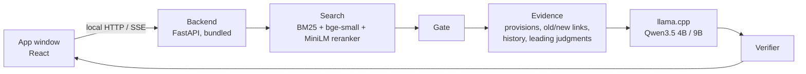

# ParAILegal

ParAILegal is an offline Indian legal research app for Windows. Ask a question about Indian law and get an answer in which each statement cites the provision or judgment it comes from. Everything runs on your own computer: the law, the search and the language models. After a one-time setup, nothing you type leaves your machine.

It is for law students, practising advocates and the general public, and covers criminal and civil law.

> This is a research tool, not legal advice. Verify every provision against the official Gazette and consult a qualified advocate for legal advice.

## Download (Windows)

ParAILegal runs as a desktop app for Windows 10 and 11 (64-bit), and works offline once set up.

1. Download the installer, **`ParAILegal_<version>_x64-setup.exe`** (about 270 MB), from the [latest release](https://github.com/sarthak213/ParAILegal/releases/latest).
2. Run it. It installs for your user only, so no administrator rights are needed.
3. Open ParAILegal and go to **Downloads** to fetch the rest once. These are hosted on Hugging Face:

   | Download | Size | What it adds | Source |
   |---|---|---|---|
   | Answer model (Qwen3.5 4B) | 2.7 GB | Written answers. Without it, Research lists the matching provisions. | [Sarthak213/parailegal-models](https://huggingface.co/Sarthak213/parailegal-models) |
   | Supreme Court judgments | 1.0 GB | Judgments search, the citator, precedents and leading cases | [Sarthak213/parailegal-sc-judgments](https://huggingface.co/datasets/Sarthak213/parailegal-sc-judgments) |
   | Case Builder model (Qwen3.5 9B) | 5.6 GB | The Case Builder, which stays locked until it is installed | [Sarthak213/parailegal-models](https://huggingface.co/Sarthak213/parailegal-models) |

   Downloads resume if they stop, and each file is checked against its SHA-256 before the app uses it.

The app installs to `%LOCALAPPDATA%\ParAILegal`; its downloads go to `%LOCALAPPDATA%\in.parailegal.desktop`. To remove everything, uninstall it from Windows' Apps settings and tick **Delete the application data**. A computer with 16 GB of RAM is recommended for the Case Builder model; the answer model needs much less. A graphics card that supports Vulkan (including recent Intel, AMD and NVIDIA chips) makes answers faster; without one, the app uses the processor.

### The installer is not code-signed

The installer is **not code-signed**, so Windows SmartScreen will warn that it is from an unknown publisher the first time you run it. To go ahead, choose **More info**, then **Run anyway**.

Check that your copy is the one published here before you run it. Each release's notes give its installer's SHA-256. Compare it with your copy's, in PowerShell:

```powershell
Get-FileHash .\ParAILegal_<version>_x64-setup.exe -Algorithm SHA256
```

If they differ, do not run the file.

## What it does

- **Research.** Ask in plain English, Hindi-English or legal terms. Search finds the relevant provisions. A gate decides whether they answer the question: a full answer, an answer with a caveat, or just the closest provisions. The answer is written only from those sources, and a verifier then removes or flags anything they do not support. Three modes: **Research** (for lawyers and students), **Summarise** (plain language) and **Advocate**.
- **Old and new law, linked.** IPC, CrPC and the Evidence Act sections link to their BNS, BNSS and BSA counterparts, both ways. A question about one brings in the other.
- **Law at the time.** Amendment history for the Constitution and every Central Act. The app can say what a provision read on a past date, what changed since, and what replaced it.
- **Supreme Court judgments.** Search, a citator (followed, distinguished, overruled), and the leading judgments that apply a provision.
- **Case Builder.** From typed facts to:
  - the offences they may disclose
  - a checklist of each offence's elements
  - procedure from the BNSS First Schedule
  - Supreme Court precedents, with what is alike and what differs
  - a cited brief

  Arguments to test, not conclusions.

### What the law covers

| | Contents |
|---|---|
| Constitution of India | The official text: Preamble, articles, 12 Schedules; 1,021 amendment notes |
| Central Acts | 892 Acts from India Code (840 in force, 52 repealed, including the IPC, CrPC and Evidence Act); 35,029 amendment notes |
| Supreme Court | 38,358 judgments, 1950–2025, with 176,833 citations between them |

Not covered yet: state Acts, rules and notifications, High Court judgments.

## How it works



- The window (Tauri) starts the backend on a free local port. The backend talks only to `127.0.0.1`.
- llama.cpp runs on the GPU through Vulkan when it can, otherwise on the processor. It is unloaded after 10 idle minutes to free memory.
- The only network use is the one-time Downloads.

## Repository layout

```text
backend/
  app/            FastAPI backend: search/, answer/ (gate, evidence, prompts, verifier),
                  case/ (Case Builder), judgments/, history/ (amendments), llm/ (llama.cpp),
                  setup/ (first-run downloads)
  scripts/        building the corpus, the judgments index and citator, section links,
                  the search pack; publishing the downloads; staging the desktop build
  eval/           retrieval, answer, Case Builder and comparison evaluations
  tests/          pytest suite
  desktop_server.py, parailegal-backend.spec   the backend as the desktop app runs it
frontend/
  src/            React + TypeScript + Vite
  src-tauri/      the desktop shell and installer (Tauri)
```

## Development

Developed with Python 3.14 and Node.js 24, on Windows.

The law, the search models and the language models are not in this repository: they are built or downloaded data. The quickest way to get them is to install the app and run its Downloads, then point a development backend at the installed copy.

**Backend**

```powershell
cd backend
python -m venv .venv
.\.venv\Scripts\Activate.ps1
python -m pip install -r requirements.txt

# use the installed app's data: the law and search models, and the downloads
$env:PARAILEGAL_RESOURCES = "$env:LOCALAPPDATA\ParAILegal\resources"
$env:PARAILEGAL_HOME = "$env:LOCALAPPDATA\in.parailegal.desktop"
python -m uvicorn app.main:app --port 8000
```

The API runs at `http://127.0.0.1:8000` (docs at `/docs`). Without these two variables, the backend looks for `backend/data` and `backend/models`. These can be rebuilt with the scripts in `backend/scripts` from the official sources: India Code, the Legislative Department's Constitution, and the Supreme Court judgments on the Registry of Open Data on AWS.

Tests: `python -m pytest --ignore=tests/test_suite.py` (`test_suite.py` is the old HTTP suite).

**Frontend**

```powershell
cd frontend
npm install
npm run dev
```

The app runs at `http://localhost:5173` and uses the backend at `http://localhost:8000`. To use another address, set `VITE_API_BASE_URL` in `frontend/.env.local`.

**Desktop build.** You need Rust and the Microsoft C++ Build Tools, plus the data above in `backend/data` and `backend/models`.

```powershell
cd backend
.\.venv\Scripts\pyinstaller parailegal-backend.spec --noconfirm   # the backend, bundled
.\.venv\Scripts\python -m scripts.stage_desktop                   # the installer's resources
cd ..\frontend
npx tauri build                                                   # src-tauri\target\release\bundle\nsis
```

**Releasing.** Releases are built and published by GitHub Actions ([release.yml](.github/workflows/release.yml)). To publish a new version:
1. Raise `version` in `frontend/src-tauri/tauri.conf.json` and `frontend/src-tauri/Cargo.toml`.
2. Merge to `master`.

The workflow then builds the installer, checks the bundled backend, and publishes release `v<version>` with the installer's SHA-256 in its notes. A push that keeps the version publishes nothing.

GitHub's build machine gets the resources that are not in this repository (search pack, amendments, llama.cpp, search models) as one archive from Hugging Face, checked against `backend/desktop/build-resources.json`. After rebuilding the corpus or the pack, publish a new archive and commit the updated file:

```powershell
.\.venv\Scripts\python -m scripts.stage_desktop --no-backend --out $env:TEMP\stage --archive $env:TEMP\build-resources.zip
.\.venv\Scripts\python -m scripts.publish_build_resources $env:TEMP\build-resources.zip --owner Sarthak213
```

## License

ParAILegal is licensed under the GNU Affero General Public License v3.0; see [LICENCE.md](LICENCE.md).

What it downloads is licensed separately:
- **The Qwen3.5 models** are by the Qwen team (Alibaba Cloud), under the Apache License 2.0.
- **The Supreme Court judgments** are from the [Indian Supreme Court Judgments](https://registry.opendata.aws/indian-supreme-court-judgments/) dataset on the Registry of Open Data on AWS, under CC-BY-4.0.
