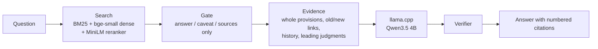

# ParAILegal: backend

The FastAPI backend of [ParAILegal](../README.md), the offline Indian legal research app. Everything runs locally:
- search over the Constitution, 892 Central Acts and their amendment history, and 38,358 Supreme Court judgments
- local language models through llama.cpp
- no API keys or cloud services

In the desktop app, the window starts this backend in the background (`desktop_server.py`, bundled by PyInstaller). In development you run it with uvicorn.

> This is a research tool, not legal advice. Verify every provision against the official Gazette and consult a qualified advocate for legal advice.

## How an answer is made



- **Search** (`app/search`): a prebuilt search pack.
  - It combines keyword search (SQLite FTS5) with sentence vectors (bge-small via fastembed, ONNX) and a cross-encoder reranker (MiniLM).
  - It handles section and article numbers, old and new criminal codes, everyday and Hindi-English words, and typos.
- **Gate** (`app/answer/gate.py`): from the search scores, decides whether to answer, answer with a caveat, or only list the closest provisions.
- **Evidence** (`app/answer/evidence.py`, `context.py`): what the model reads, written by code. For each provision:
  - its text
  - what it replaced or what replaced it ("Formerly Section 154 of the CrPC")
  - its latest amendments
  - the Supreme Court judgments that deal most with it (names only)
- **Answer model** (`app/llm`): llama.cpp's `llama-server`, run as a child process.
  - It runs on the GPU through Vulkan when it can, otherwise on the processor.
  - It is started on the first question and stopped after 10 idle minutes.
  - It is tied to the backend's process, so it never outlives it.
- **Verifier** (`app/answer/verify.py`): removes citations that point nowhere, and flags any provision or figure the sources do not contain, and sentences that state the law without a citation.

Without the answer model, answers list the matching provisions (sources only).

## Repository layout

All paths are relative to `backend/`; run every command from here.

```text
app/
  main.py               FastAPI app, /health and /ready
  api/routes/           search, answer, judgments, case (Case Builder), setup (downloads), admin
  core/config.py        settings and the two folders (see Configuration)
  search/               the search engine and its pack: BM25, dense vectors, reranker, query parsing
  answer/               gate, evidence and context, prompts, verifier, follow-ups, urgent notices
  llm/                  llama-server (start, stop, GPU or CPU) and its client
  case/                 Case Builder: facts, offences, elements, BNSS schedule, precedents
  judgments/            judgments store and search, citator, law at the time
  history/              amendment history from India Code's footnotes, earlier wordings
  setup/                first-run downloads: manifest.json, resumable checked downloader
  services/             the search service; v1 (cloud) code kept for SEARCH_ENGINE=v1
scripts/                building the corpus and indexes; packaging (below)
eval/                   evaluations (below)
tests/                  pytest suite
desktop/                desktop build: pinned requirements, build-resources record, third-party notices
desktop_server.py       the backend as the desktop app runs it
parailegal-backend.spec PyInstaller recipe for the desktop backend
```

## Running it

Developed with Python 3.14 on Windows.

```powershell
python -m venv .venv
.\.venv\Scripts\Activate.ps1
python -m pip install -r requirements.txt
python -m uvicorn app.main:app --port 8000
```

The API is at `http://127.0.0.1:8000`, with interactive docs at `/docs`.

**Data.** The backend needs data that is not in this repository:
- the search pack and amendment history
- the search models and the llama.cpp engine
- optionally, the answer and Case Builder models and the judgments

The quickest way to get them is to install the desktop app and run its Downloads, then point this backend at its folders:

```powershell
$env:PARAILEGAL_RESOURCES = "$env:LOCALAPPDATA\ParAILegal\resources"
$env:PARAILEGAL_HOME = "$env:LOCALAPPDATA\in.parailegal.desktop"
```

Without these, it looks in `backend/data` and `backend/models`. Those can be rebuilt from the official sources with the scripts below.

Start-up takes a few seconds; `/ready` reports `starting`, then `ready` (or `failed` with the reason).

## Configuration

Settings live in `app/core/config.py`; any of them can be set as an environment variable or in `backend/.env`.

| Setting | Default | Purpose |
|---|---|---|
| `PARAILEGAL_RESOURCES` | `backend/` | Read-only data: `data/pack`, `data/amendments`, `models/engine`, `models/fastembed` |
| `PARAILEGAL_HOME` | `backend/` | Downloaded data: `models/llm/*.gguf`, `data/judgments`; and `logs` in the desktop app |
| `PARAILEGAL_MANIFEST` | `app/setup/manifest.json` | Where the first-run downloads come from |
| `SEARCH_ENGINE` | `v2` | `v2`: offline. `v1`: the old cloud setup (Qdrant, Cohere, Groq, Sarvam; needs their keys) |
| `DENSE_MODEL` / `RERANK_MODEL` | `bge-small` / `minilm-l6` | Search models; `""` turns one off |
| `LLM_MODEL_PATH` | `models/llm/Qwen3.5-4B-Q4_K_M.gguf` | Answer model (under the data folder) |
| `CASE_MODEL_PATH` | `models/llm/Qwen3.5-9B-Q4_K_M.gguf` | Case Builder model; without it the Case Builder is locked |
| `LLM_DEVICE` | `auto` | `auto` (GPU, then CPU), `gpu` or `cpu` |
| `LLM_THREADS` / `LLM_BATCH_THREADS` | `6` / `8` | CPU threads, kept down so a laptop stays cool |
| `LLM_CTX` | `8192` | Model context size |
| `LLM_IDLE_UNLOAD_S` | `600` | Stop the model after this many idle seconds |
| `LLM_PRELOAD` | `false` | Load the answer model at start-up instead of on the first question |

## API

Every route except `/health` and `/ready` answers 503 until start-up has finished.

| Route | What it does |
|---|---|
| `GET /health`, `GET /ready` | Liveness; readiness with index counts and the models' state |
| `POST /api/v1/search` | Search: `{query, k, domain}`; `domain` is `constitution`, `statutes`, `judgements` or `all` |
| `POST /api/v1/answer` | A full answer, as JSON |
| `POST /api/v1/answer/stream` | The answer as Server-Sent Events (below) |
| `POST /api/v1/judgments/search`, `GET /api/v1/judgments/{id}` | Supreme Court judgments, with the citator's record |
| `POST /api/v1/case/facts` → `offences` → `elements` → `precedents` → `compare` → `brief` | The Case Builder, step by step (`brief` streams). Answers 423 until the Case Builder model is installed |
| `GET /api/v1/setup`, `POST /api/v1/setup/download`, `POST /api/v1/setup/cancel` | First-run downloads: what is installed, start one, pause it |
| `GET /api/v1/admin/stats` | Index counts |

**Answers** take `{query, mode, previous, domain}`:
- `mode` is `research` (the default), `summarise` (plain language) or `advocate`.
- `previous` is the question answered just before and its sources' chunk IDs; the backend decides whether the new question follows it up.

**The stream** sends, in order:
- `sources`
- `gate`: the outcome, and whether it read the question as a follow-up
- `status`: loading the model, thinking
- `token` events
- `done`: the full answer, its citations, and the verifier's findings

or `error` on failure.

The server binds to whatever host you give uvicorn. The desktop app binds `127.0.0.1` only. There is no authentication: keep it local.

## Building the data

The corpus is built from official sources:
- India Code's PDFs
- the Legislative Department's Constitution
- the Supreme Court judgments on the Registry of Open Data on AWS (CC-BY-4.0)

| Script | Builds |
|---|---|
| `build_corpus.py` | The statute corpus and the amendment history, from an India Code harvest |
| `build_constitution.py` | The Constitution, from the official PDF |
| `fetch_replaced_statutes.py` | Official texts of repealed codes (IPC, CrPC, Evidence Act, labour laws) |
| `link_new_codes.py`, `derive_section_links.py` | Old → new section links (criminal codes, labour codes) |
| `fetch_archived_acts.py`, `fill_old_wordings.py` | Earlier wordings the amendment footnotes leave out, from archived copies |
| `check_corpus.py` | Quality report; must pass |
| `build_pack.py` | The search pack from the corpus |
| `build_judgments.py`, `build_judgments_index.py`, `build_citator.py` | The judgments corpus, its index and the citator |

Run with `PYTHONUTF8=1`: some titles contain characters the Windows console cannot print.

## Packaging and releases

| Script | Does |
|---|---|
| `stage_desktop.py` | Puts together what the installer carries; `--no-backend --archive` makes the build-resources archive |
| `publish_build_resources.py` | Publishes that archive to Hugging Face and records it in `desktop/build-resources.json` |
| `publish_downloads.py` | Publishes the first-run downloads to Hugging Face and fills in `app/setup/manifest.json` |

Releases are built by GitHub Actions ([release.yml](../.github/workflows/release.yml)): raise the version in `frontend/src-tauri/tauri.conf.json` and `Cargo.toml`, then merge to master. See the [main README](../README.md#development).

## Tests and evaluations

```powershell
python -m pytest --ignore=tests/test_suite.py
```

`tests/test_suite.py` is the old HTTP suite for the v1 setup.

| Evaluation | Measures |
|---|---|
| `eval/retrieval.py` | Retrieval: hit@k, recall, MRR, nDCG over 279 graded questions |
| `eval/answers.py` | Answers end to end with a given model: citations, key facts, verifier findings, speed |
| `eval/links.py` | Whether old ↔ new section links reach the answer model |
| `eval/case_offences.py` | Whether the Case Builder finds the expected offences |
| `eval/case_compare.py` | The Case Builder's precedent comparisons |
| `eval/calibrate_gate.py`, `eval/tune.py` | Fitting the gate's thresholds and the search weights (on the dev split) |

Results go to `eval/results/` and model replies are cached in `data/eval/`; neither is committed.
